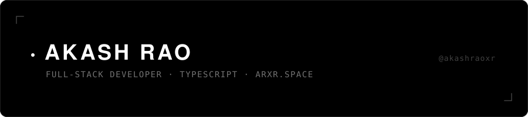

  
    
  

 

  
  

 

 

  

 

 

### `02 // TECH STACK`

**Languages**

  
  
  
  
  
  
  
  
  
  
  
  
  
  
  
  
  

**Frontend & Mobile**

  
  
  
  
  
  
  
  
  
  
  
  
  
  
  
  

**Backend, APIs & Runtimes**

  
  
  
  
  
  
  
  
  
  
  
  
  
  

**Databases & ORMs**

  
  
  
  
  
  
  
  
  
  

**Cloud, DevOps & Infrastructure**

  
  
  
  
  
  
  
  
  
  
  

**AI / ML, Testing & Tooling**

  
  
  
  
  
  
  
  
  
  
  

 

 

### `03 // TELEMETRY`

  
  

 

  

